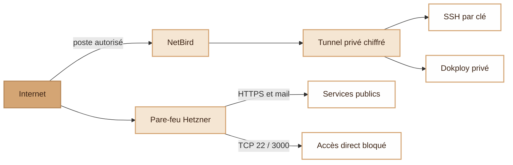
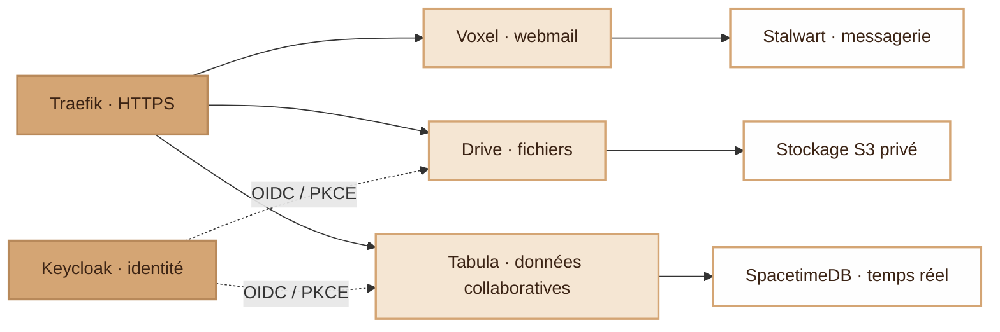
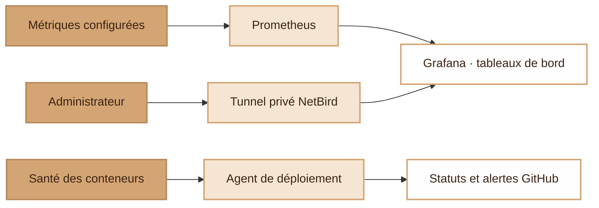
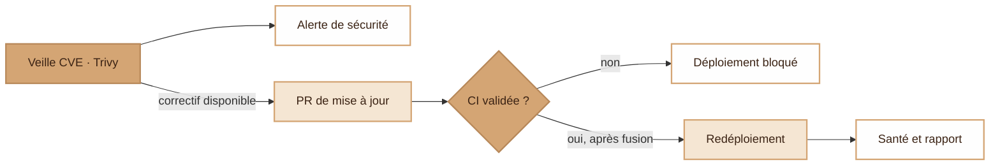

  <picture>
    <source media="(prefers-color-scheme: dark)" srcset="assets/ms-dark.svg">
    
  </picture>

<h1 align="center">modern-stack</h1>

Your own cloud, with private server access and controlled delivery.

**modern-stack** brings email, file storage, collaborative data and identity together on one server. Secure access, supervision and the security-update cycle are built into its architecture.

## Private access comes first

Server administration starts with **NetBird**: an authorized device enters an encrypted private tunnel before reaching SSH or Dokploy.

The **Hetzner firewall blocks direct public SSH and Dokploy access** on IPv4 and IPv6. SSH keys and the Dokploy login still authenticate the administrator. Public applications and mail remain reachable through their intended entry points.

## Connected services, integrated identity

**Traefik** provides the HTTPS entry point. **Keycloak** handles OIDC authentication and application roles for Drive and Tabula, with PKCE and controlled redirects.

[Voxel](https://github.com/djdevpro/voxel) provides webmail over Stalwart; [Drive](https://github.com/djdevpro/s3drive) keeps files in private S3 storage; Tabula uses SpacetimeDB for collaborative data in real time. Keycloak persists identity in PostgreSQL. Each service keeps its own data layer.

## Supervision with Prometheus and Grafana

**Grafana** provides private dashboards backed by **Prometheus**. Container health checks and deployment reports add a second view: whether a release actually reached a healthy running state.

Dashboards and their data source are versioned alongside the platform. GitHub exposes deployment status and opens an issue when a deployment fails. [Monitoring scope and configured targets](docs/operations.md#supervision) distinguish available dashboards from metrics actually collected.

## From a CVE to a verified redeployment

**Trivy** scans pinned images every night. Security findings are reported; rebuilt images and **Dependabot** updates enter the same review and validation path.

CI checks infrastructure, scripts, workflows and image security. Eligible updates can merge automatically after validation; other changes require review. The server **pulls** approved changes, refuses conflicting manual edits, redeploys and reports health. GitHub runners need no SSH access to production.

Tabula adds a staged release policy: builds, container checks and scans, a notification, **at least four hours to intervene**, then promotion and a backup before deployment.

## Built to operate

**Terraform** defines infrastructure, private access and application configuration. **Docker Compose** keeps services reproducible, with persistent data, pinned images and explicit resource limits where configured. Secrets are supplied outside Git; state and backups remain private.

- [Terraform guide](docs/terraform.md) — commands, provisioning diagrams and prerequisites.
- [Operations and security](docs/operations.md) — network boundaries, monitoring coverage and the CVE/redeployment cycle.
- [Private administration](terraform/PRIVATE-ADMIN.md) — access policy and recovery.

The diagrams are editable Mermaid sources. Keep architecture and implementation changes together in the same PR.
