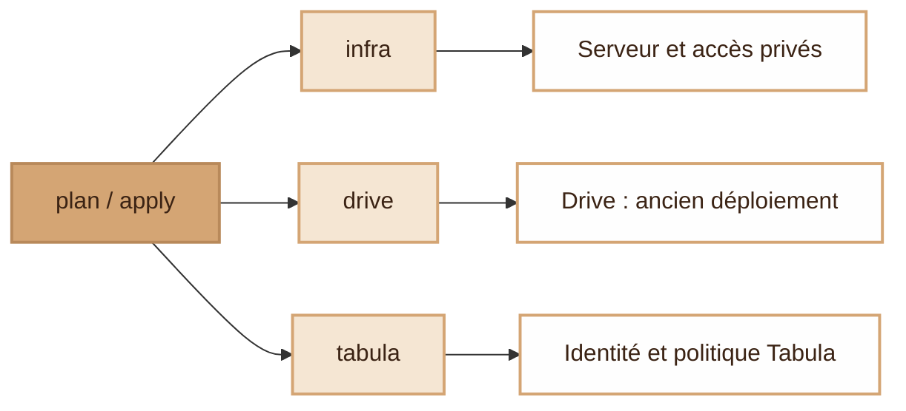

# modern-stack

A self-hosted platform on a single small server: mail, single sign-on, monitoring and your own apps, deployed and kept up to date automatically.

## The idea

- **Terraform** creates the server (Hetzner) with its firewall; private admin access goes through a NetBird VPN.
- **Docker Compose** runs the core services: Stalwart (mail), Keycloak (single sign-on), Prometheus and Grafana (monitoring), behind Traefik with automatic HTTPS. Dokploy deploys the other apps.
- **In-house apps** ([Voxel](https://github.com/djdevpro/voxel) webmail, [S3drive](https://github.com/djdevpro/s3drive)) build their own images on GitHub; the stack pins them like any other image.
- **Git is the source of truth.** A small agent on the server pulls `main`, waits for a green CI, applies the change and checks the containers are healthy. Nothing can push into the server.
- **Security updates are automatic.** Images are pinned by digest. Every night Trivy scans them for CVEs, Dependabot opens the fix, and safe patches are merged and deployed without anyone touching the server.

## Terraform

`python setup.py plan <stack>` previews changes; `apply <stack>` applies them.

[Detailed diagrams, prerequisites and maintenance](docs/terraform.md) distinguish Terraform provisioning from ongoing deployment. The legacy Drive stack still needs migration to private SSH and image-based deployment.

## Layout

| Folder | Content |
|---|---|
| `terraform/` | Server, firewall, reverse DNS |
| `terraform/drive/` | Drive storage, identity, DNS and legacy deployment |
| `terraform/tabula/` | Tabula identity, SMTP, initial account and update policy |
| `stack/` | Core services (Docker Compose) and helper scripts |
| `deploiement/` | Pull-based deployment agent |
| `.github/` | CI, deployment status, nightly CVE scan, Dependabot |

No secrets live in this repository.
