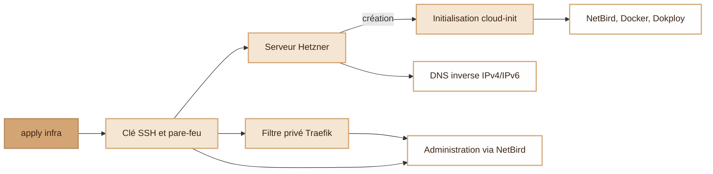
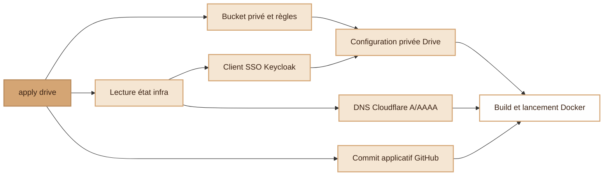
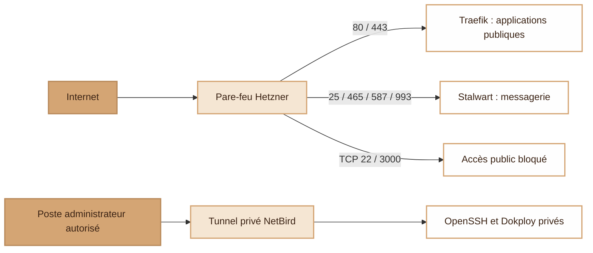

# modern-stack

<picture>
  <source media="(prefers-color-scheme: dark)" srcset="assets/ms-dark.svg">
  
</picture>

A self-hosted platform on one server: mail, single sign-on, monitoring and applications. Terraform manages infrastructure and access policies; GitHub validates changes; the server pulls approved releases.

Docker Compose runs **Stalwart, Keycloak, PostgreSQL, Prometheus and Grafana** behind Traefik. Dokploy manages applications; [Voxel](https://github.com/djdevpro/voxel) and [S3drive](https://github.com/djdevpro/s3drive) publish their own container images.

## Infrastructure

`python setup.py plan infra` previews changes; `python setup.py apply infra` applies them.

Cloud-init runs at creation; later applies reconcile managed resources and the private Dokploy route. [Prerequisites and lifecycle limits](docs/terraform.md) explain what an apply changes on an existing server.

## Drive

Storage, identity and application configuration are connected through Terraform:

**Legacy path:** this diagram reflects `terraform/drive/`, which still uses public SSH and a server-side build. Production uses the image-based `drive` service in `stack/`; [migration is required](docs/terraform.md) before reusing the old deployment path.

## Security

**The Hetzner firewall blocks public SSH, in IPv4 and IPv6. NetBird provides the private network used to reach the server.** An authorized workstation joins NetBird, then OpenSSH authenticates the administrator with an SSH key. Dokploy also remains behind its application login.

Public UDP 51820 supports NetBird's direct tunnel; UDP 443 supports HTTP/3. Other inbound ports are denied by the [cloud firewall](terraform/main.tf).

| Protection | Implementation |
|---|---|
| SSH authentication | Keys only, no root/password login; restricted users, retry limits and Fail2ban configured by [cloud-init](terraform/cloud-init.yaml.tftpl). |
| Private administration | TCP 22/3000 closed publicly; a [Traefik IP allowlist](terraform/configure-private-admin.py) also protects Dokploy's HTTP route and does not trust a client-supplied `X-Forwarded-For`. |
| Application identity | Keycloak SSO; Tabula's [public OIDC client](terraform/tabula/configure.py) uses PKCE and configured redirect URLs. |
| Secrets and state | [setup.py](setup.py) loads credentials outside the repository. Terraform state and plans stay private; Tabula's generated passwords remain in server files with mode 0600. |
| Data protection | Configurable server backups/deletion protection, a protected Drive bucket, and a [Tabula backup](stack/tabula/deploy.sh) before deployment. |
| Observability | [Prometheus and Grafana](stack/compose.yaml), container health checks and [deployment reports](.github/workflows/cd.yml). |

## Delivery and updates

- **Validate:** [CI](.github/workflows/ci.yml) checks Git history for secrets, Terraform format/validation/lint, Compose, scripts, workflows, infrastructure misconfigurations and changed container images.
- **Deploy:** the [server agent](deploiement/agent.sh) polls `main` every five minutes, requires successful CI, refuses conflicting manual edits and checks container health. CI runners need no inbound SSH access to production.
- **Patch:** images are pinned by digest. [Nightly CVE scans](.github/workflows/veille-securite.yml) and Dependabot propose updates; [defined update categories](.github/workflows/fusion-auto.yml) can merge after required checks. System packages use unattended upgrades configured at bootstrap.
- **Stage Tabula releases:** builds, container checks and scans precede a GitHub notification; promotion waits at least four hours, with a manual veto. Terraform manages the delay and server timer. [Full release flow and controls](docs/terraform.md).

The Mermaid sources live in this README and the [Terraform guide](docs/terraform.md). Update them alongside implementation changes in the same PR.

## Layout

| Folder | Content |
|---|---|
| `terraform/` | Server, firewall, reverse DNS |
| `terraform/drive/` | Drive storage, identity, DNS and legacy deployment |
| `terraform/tabula/` | Tabula identity, SMTP, initial account and update policy |
| `stack/` | Core services (Docker Compose) and helper scripts |
| `deploiement/` | Pull-based deployment agent |
| `.github/` | CI, deployment status, nightly CVE scan, Dependabot |

No secrets live in this repository.
