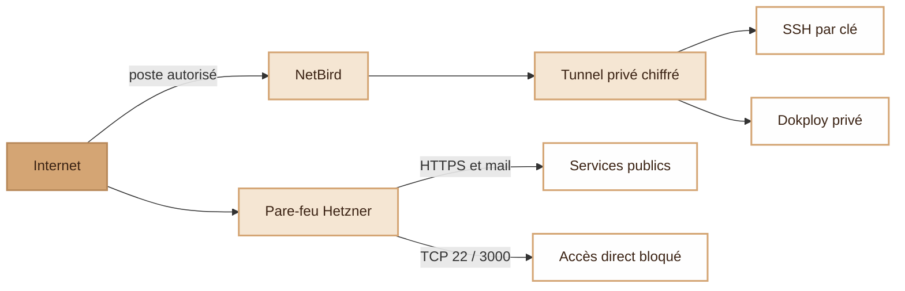
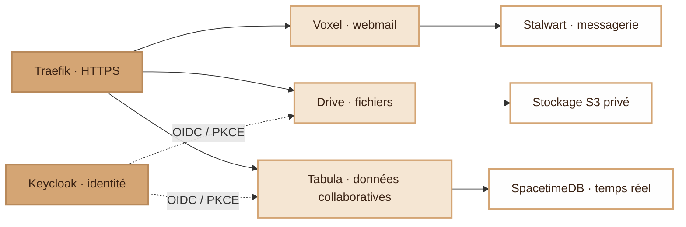
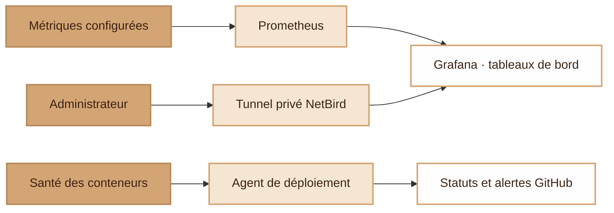
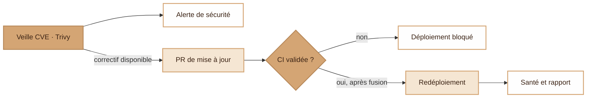

  <picture>
    <source media="(prefers-color-scheme: dark)" srcset="assets/ms-dark.svg">
    
  </picture>

<h1 align="center">modern-stack</h1>

Messagerie, fichiers et collaboration sur un serveur géré avec Terraform.

**modern-stack** réunit une messagerie, un Drive et Tabula sur un seul serveur. L'accès SSH passe par NetBird, Keycloak gère les identités et les mises à jour passent par la CI avant leur déploiement.

## Un accès privé pour administrer le serveur

Pour accéder à SSH ou Dokploy, le poste de l'administrateur doit rejoindre le tunnel privé chiffré **NetBird**.

Le **pare-feu Hetzner bloque l'accès public direct à SSH et Dokploy**, en IPv4 et IPv6. L'administrateur se connecte ensuite avec sa clé SSH ou son compte Dokploy. Les applications publiques et la messagerie restent accessibles depuis Internet.

## Services et gestion des identités

**Traefik** fournit le point d'entrée HTTPS. **Keycloak** gère l'authentification OIDC et les rôles applicatifs de Drive et Tabula, avec PKCE et des redirections contrôlées.

[Voxel](https://github.com/djdevpro/voxel) fournit l'interface de messagerie de Stalwart ; [Drive](https://github.com/djdevpro/s3drive) conserve les fichiers dans un stockage S3 privé ; Tabula s'appuie sur SpacetimeDB pour les données collaboratives en temps réel. Keycloak stocke les identités dans PostgreSQL.

## Supervision avec Prometheus et Grafana

**Grafana** affiche les métriques collectées par **Prometheus** dans des tableaux de bord accessibles via NetBird. Les contrôles de santé des conteneurs servent aussi à vérifier l'état des services après un déploiement.

Les tableaux de bord et leur source de données sont versionnés. GitHub affiche l'état des déploiements et ouvre une issue en cas d'échec. Dans la [configuration actuelle](docs/operations.md#supervision), Prometheus ne collecte pour l'instant que ses propres métriques.

## D'une CVE au redéploiement vérifié

**Trivy** analyse chaque nuit les images épinglées. Les vulnérabilités sont signalées ; les images reconstruites et les mises à jour proposées par **Dependabot** passent par une revue et les contrôles de la CI.

La CI vérifie l'infrastructure, les scripts, les workflows et la sécurité des images. Les mises à jour prévues par la politique de fusion automatique peuvent être intégrées après validation. Les autres demandent une revue.

Le serveur **récupère lui-même les changements approuvés**. Il refuse d'écraser des modifications manuelles conflictuelles, redéploie les services concernés et remonte leur état de santé. GitHub Actions n'a besoin d'aucun accès SSH à la production.

Pour Tabula, les images sont construites, testées et analysées avant l'envoi d'une notification. La promotion attend alors **au moins quatre heures**, pour laisser le temps d'intervenir. Le serveur sauvegarde les données avant le déploiement.

## Configuration et exploitation

**Terraform** définit l'infrastructure, les accès privés et la configuration des applications. **Docker Compose** décrit les services, leurs données persistantes, leurs images épinglées et les limites de ressources configurées. Les secrets sont fournis hors de Git ; les états Terraform et les sauvegardes restent privés.

- Le [guide Terraform](docs/terraform.md) détaille les commandes, les schémas de provisionnement et les prérequis.
- Le guide [Exploitation et sécurité](docs/operations.md) décrit les accès réseau, la couverture de supervision et le cycle CVE/redéploiement.
- Le guide d'[administration privée](terraform/PRIVATE-ADMIN.md) explique comment se connecter et rétablir un accès.

Les schémas Mermaid se modifient directement dans le README. Ils doivent évoluer dans la même PR que l'architecture.
