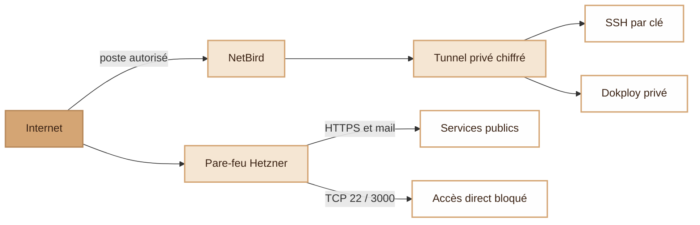
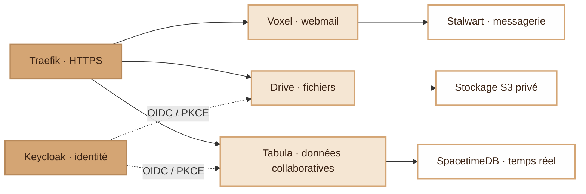
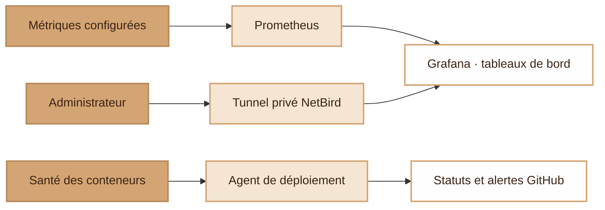
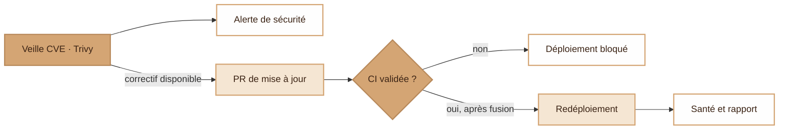

  <picture>
    <source media="(prefers-color-scheme: dark)" srcset="assets/ms-dark.svg">
    
  </picture>

<h1 align="center">modern-stack</h1>

Votre cloud, des accès privés et des mises en production maîtrisées.

**modern-stack** réunit messagerie, stockage de fichiers, données collaboratives et gestion des identités sur un seul serveur. Accès sécurisés, supervision et mises à jour de sécurité font partie de son architecture.

## Un accès privé pour administrer le serveur

L’administration du serveur commence par **NetBird** : un poste autorisé rejoint un tunnel privé chiffré avant d’accéder à SSH ou Dokploy.

Le **pare-feu Hetzner bloque l’accès public direct à SSH et Dokploy**, en IPv4 comme en IPv6. L’administrateur doit toujours s’authentifier par clé SSH ou sur la page de connexion Dokploy. Les applications publiques et la messagerie restent accessibles par leurs points d’entrée prévus.

## Services et gestion des identités

**Traefik** fournit le point d’entrée HTTPS. **Keycloak** gère l’authentification OIDC et les rôles applicatifs de Drive et Tabula, avec PKCE et des redirections contrôlées.

[Voxel](https://github.com/djdevpro/voxel) fournit l’interface de messagerie de Stalwart ; [Drive](https://github.com/djdevpro/s3drive) conserve les fichiers dans un stockage S3 privé ; Tabula s’appuie sur SpacetimeDB pour les données collaboratives en temps réel. Keycloak stocke les identités dans PostgreSQL. Chaque service dispose de son propre stockage.

## Supervision avec Prometheus et Grafana

**Grafana** propose des tableaux de bord privés alimentés par **Prometheus**. Les contrôles de santé des conteneurs et les rapports de déploiement permettent aussi de suivre l’état d’une version après sa mise en service.

Les tableaux de bord et leur source de données sont versionnés avec la plateforme. GitHub affiche l’état des déploiements et ouvre une issue en cas d’échec. Le [périmètre de supervision](docs/operations.md#supervision) précise quelles métriques sont réellement collectées.

## D’une CVE au redéploiement vérifié

**Trivy** analyse chaque nuit les images épinglées. Les vulnérabilités sont signalées ; les images reconstruites et les mises à jour proposées par **Dependabot** suivent le même parcours de revue et de validation.

Les contrôles d’intégration continue (CI) vérifient l’infrastructure, les scripts, les workflows et la sécurité des images. Les mises à jour éligibles peuvent être fusionnées automatiquement après validation ; les autres nécessitent une revue. Le serveur **récupère lui-même** les changements approuvés, refuse d’écraser des modifications manuelles conflictuelles, redéploie et remonte l’état de santé. GitHub Actions n’a besoin d’aucun accès SSH à la production.

Tabula ajoute une publication par étapes : compilation, contrôles des conteneurs et analyses de sécurité, notification, **au moins quatre heures pour intervenir**, puis promotion de la version et sauvegarde avant déploiement.

## Pensé pour l’exploitation

**Terraform** définit l’infrastructure, les accès privés et la configuration des applications. **Docker Compose** rend les déploiements reproductibles : données persistantes, images épinglées et limites de ressources explicites lorsqu’elles sont configurées. Les secrets sont fournis hors de Git ; les états Terraform et les sauvegardes restent privés.

- [Guide Terraform](docs/terraform.md) — commandes, schémas de provisionnement et prérequis.
- [Exploitation et sécurité](docs/operations.md) — frontières réseau, couverture de supervision et cycle CVE/redéploiement.
- [Administration privée](terraform/PRIVATE-ADMIN.md) — politique d’accès et rétablissement de l’accès.

Les schémas sont des sources Mermaid modifiables. Mettez-les à jour dans la même PR que les changements d’architecture.
