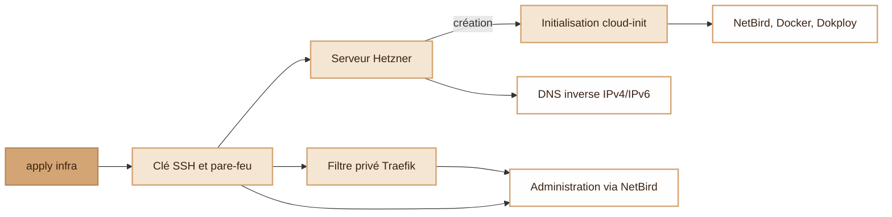
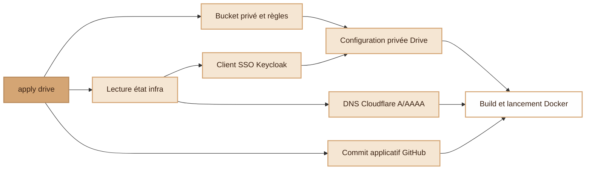
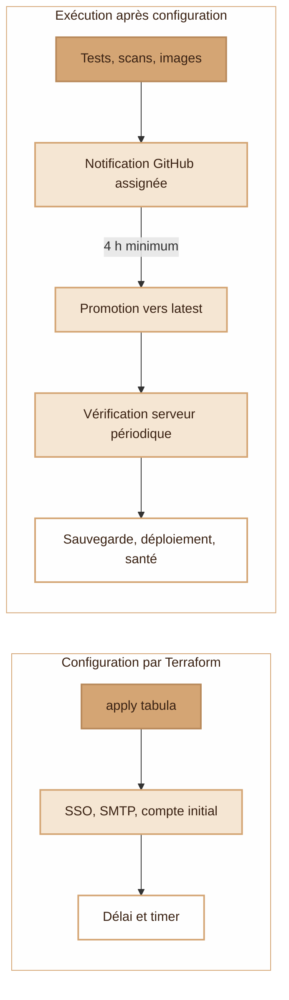

# Ce que fait Terraform

Le projet contient trois piles indépendantes, `infra`, `drive` et `tabula`. Choisir une pile, puis utiliser `python setup.py plan <pile>` pour voir les changements et `python setup.py apply <pile>` pour les appliquer.

Le lanceur charge uniquement les secrets nécessaires depuis le magasin local, hors dépôt. Chaque pile stocke son état dans un objet S3 distinct. Les états et les plans restent privés, car ils peuvent contenir des secrets.

## 1. Serveur et accès privés (infra)

- Terraform gère le serveur IPv4/IPv6, la clé SSH, le pare-feu et les deux enregistrements PTR. `backups` et `protected` règlent les sauvegardes et la protection contre la suppression ou la réinstallation.
- Au premier démarrage, cloud-init crée le compte administrateur et configure le SSH par clé, les mises à jour système, Fail2ban, le swap et les utilitaires. La connexion SSH en root ou par mot de passe est interdite. NetBird rejoint le réseau si sa clé est fournie. L'installation de Dokploy reste optionnelle.
- À chaque apply, le filtre Traefik limite la route HTTP de Dokploy aux réseaux NetBird. Le serveur doit déjà être joignable par NetBird, sa clé SSH doit être reconnue et Dokploy doit être installé. Ce script n'attend pas la fin de l'initialisation d'un serveur neuf.
- Le pare-feu public autorise TCP 80/443 et 25/465/587/993, ainsi qu'UDP 443 et 51820. Il bloque TCP 22 et 3000 en IPv4 et IPv6. L'accès privé utilise OpenSSH via NetBird.
- Les modifications de `cloud-init`, de l'image et des clés SSH ne reconfigurent pas un serveur existant en raison d'`ignore_changes`. La pile indique les DNS applicatifs et mail en sortie, sans les créer. Elle ne déploie ni les services de `stack/` ni leur agent Git.

Ces actions sont définies dans [main.tf](../terraform/main.tf), [cloud-init](../terraform/cloud-init.yaml.tftpl), [private-admin.tf](../terraform/private-admin.tf) et le [script du filtre](../terraform/configure-private-admin.py). Le fichier [outputs.tf](../terraform/outputs.tf) définit les sorties.

## 2. Stockage et ancien déploiement (drive)

**Cette pile doit être corrigée avant d'être réutilisée.** Elle contacte encore l'IP publique en SSH et construit le Drive sur le serveur. Le déploiement actuel utilise NetBird pour l'administration et une image du service `drive` depuis `stack/`. Le schéma décrit le code de cette ancienne pile. Attendre sa migration avant de s'en servir pour mettre à jour l'application.

- Terraform empêche la destruction du bucket privé. Les règles CORS autorisent l'origine du Drive. Les envois multipart abandonnés sont nettoyés après le délai configuré.
- Avant `plan`/`apply`, le lanceur vérifie que les clés S3 du Drive n'ouvrent pas le bucket d'état. Les IP du serveur viennent de l'état `infra`. Cloudflare gère le DNS public.
- La pile prépare le client Keycloak, les URL, le `.env`, les fichiers de configuration et les conditions d'utilisation. Elle génère une seule fois la clé maîtresse du Drive et la conserve dans l'état. Elle ajoute le secret du client SSO sur le serveur.
- Un changement de commit GitHub ou de configuration déclenche l'ancien déploiement, qui contrôle ensuite la santé du conteneur. Keycloak et la configuration d'administration du serveur doivent déjà exister.

Le code de cette pile se trouve dans [main.tf](../terraform/drive/main.tf), l'[installation du .env](../terraform/drive/install-env.sh), la [configuration Keycloak](../terraform/drive/keycloak/configure.mjs) et l'[ancien déploiement](../terraform/drive/app/deploy-app.sh). Le service actuel est défini dans [stack/compose.yaml](../stack/compose.yaml).

## 3. Identité et mises à jour (tabula)

- Avant l'apply, Keycloak, Stalwart et le compte expéditeur doivent exister. SSH doit passer par NetBird avec vérification de la clé du serveur. Les scripts `stack/tabula/` doivent être déployés, Docker doit pouvoir lire les images privées et `gh` doit disposer localement des droits de configuration du dépôt applicatif.
- À chaque apply, Terraform aligne le realm `tabula`, le client public PKCE, les URL du frontal/backend, les rôles et les scopes sur la configuration. Le SMTP réutilise le compte expéditeur avec un accès d'application dédié. Le serveur génère le mot de passe initial du premier administrateur. Les apply suivants ne réinitialisent pas les mots de passe.
- Les accès initiaux sont écrits dans une section du `~/acces.txt` de l'administrateur SSH, avec une copie root dans `/opt/tabula/bootstrap.json`. Le secret SMTP est conservé dans `/opt/tabula/smtp.json`. Ces fichiers ont les permissions 0600. Aucun de ces mots de passe ne va dans l'état Terraform.
- `update_policy.grace_hours` règle la variable GitHub `TABULA_UPDATE_GRACE_HOURS`, de 4 à 168 h. `check_interval_minutes` règle le timer serveur de 5 à 60 min, avec 15 min par défaut. `enabled` l'active ou l'arrête. L'apply ne publie ni ne déploie une nouvelle version de Tabula.
- Le dépôt applicatif construit, teste et analyse ensuite la version avant de publier les images privées et d'envoyer la notification. La promotion périodique attend le délai indiqué dans l'issue. Le serveur exige deux images de même version, les fixe par empreinte, sauvegarde les données, déploie et contrôle la santé. Le délai n'est pas une heure de déploiement exacte.
- Pour bloquer une mise à jour, ajouter l'étiquette `hold` ou fermer l'issue avant la promotion. Le fichier `/opt/tabula/hold` bloque aussi la mise à jour côté serveur. Un déploiement échoué crée `/opt/tabula/update-failed` et bloque les tentatives suivantes. Aucune restauration destructive des données ne se fait automatiquement.

La configuration utilise [main.tf](../terraform/tabula/main.tf), la [configuration d'identité](../terraform/tabula/configure.py) et la [configuration SMTP](../terraform/tabula/mail.py). La politique de mise à jour s'appuie sur [updates.tf](../terraform/tabula/updates.tf), la [configuration GitHub](../terraform/tabula/configure-release.py) et la [configuration systemd](../terraform/tabula/configure-updates.py). Les scripts de [consommation des images](../stack/tabula/update.py) et de [déploiement](../stack/tabula/deploy.sh) appliquent les versions sur le serveur. Les workflows de construction et de promotion appartiennent au dépôt applicatif défini par `update_policy.repository`.

## Maintenir ces schémas

Les blocs Mermaid du [README](../README.md) et de cette page sont les sources des schémas. GitHub les affiche directement. Modifier le schéma et ses limites dans **la même PR** qu'une ressource, un provisioner, un prérequis réseau ou une politique de mise à jour. Vérifier les liens vers les fichiers et le rendu Mermaid.

`terraform graph` montre les dépendances Terraform. Pour comprendre les actions exécutées, relire aussi les scripts et les workflows liés ci-dessus.
