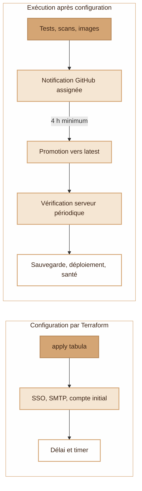

# Ce que fait Terraform

Les trois piles sont indépendantes : `python setup.py plan <pile>` montre les changements ; `python setup.py apply <pile>` les applique. Choisir **une** pile parmi `infra`, `drive` et `tabula`. Le lanceur charge uniquement les secrets nécessaires depuis le magasin local, hors dépôt. Chaque pile conserve son état dans une clé S3 distincte ; l'état et les plans peuvent contenir des secrets et restent privés.

## 1. Serveur et accès privés — infra

[Schéma du serveur dans le README](../README.md#infrastructure) · [Accès publics et privés](../README.md#security)

- **Ressources gérées :** serveur IPv4/IPv6, clé SSH, pare-feu et deux PTR. Sauvegardes et protection contre suppression/réinstallation dépendent de `backups` et `protected`.
- **Au premier démarrage :** compte administrateur, SSH par clé, root et mot de passe interdits, mises à jour système, Fail2ban, swap et utilitaires. NetBird rejoint le réseau si sa clé est fournie ; l'installation de Dokploy est optionnelle.
- **À chaque apply :** le filtre Traefik limite aussi la route HTTP de Dokploy aux réseaux NetBird. Le script nécessite déjà un serveur joignable par NetBird, la clé SSH reconnue et Dokploy installé ; il n'attend pas leur initialisation lors d'une création neuve.
- **Ports publics autorisés :** TCP 80/443 et 25/465/587/993 ; UDP 443 et 51820. TCP 22 et 3000 sont bloqués en IPv4 et IPv6. L'accès privé utilise OpenSSH via NetBird.
- **Limites :** modifier `cloud-init`, l'image ou les clés SSH ne reconfigure pas un serveur existant (`ignore_changes`). Les DNS applicatifs et mail sont indiqués en sortie ; cette pile ne les crée pas. Elle ne déploie pas les services de `stack/` ni leur agent Git.

Sources : [main.tf](../terraform/main.tf), [cloud-init](../terraform/cloud-init.yaml.tftpl), [private-admin.tf](../terraform/private-admin.tf), [script du filtre](../terraform/configure-private-admin.py), [outputs.tf](../terraform/outputs.tf).

## 2. Stockage et ancien déploiement — drive

[Schéma du Drive dans le README](../README.md#drive)

**Écart à corriger avant réutilisation :** le code de cette pile contacte encore l'IP publique en SSH et construit le Drive sur le serveur. Il n'est pas aligné avec l'administration privée par NetBird ni avec le déploiement actuel du service `drive` par image depuis `stack/`. Ce diagramme représente bien ce que le code ferait ; ne pas utiliser cet ancien chemin pour mettre à jour l'application avant sa migration.

- Le bucket privé interdit sa destruction par Terraform. CORS autorise l'origine du Drive ; les envois multipart abandonnés sont nettoyés après le délai configuré.
- Le lanceur vérifie avant `plan`/`apply` que les clés S3 du Drive n'ouvrent pas le bucket d'état. Les IP du serveur viennent de l'état `infra` ; le DNS public vient de Cloudflare.
- Le client Keycloak, les URL, le `.env`, les fichiers de configuration et les conditions d'utilisation sont préparés. La clé maîtresse du Drive est générée une seule fois et conservée dans l'état ; le secret du client SSO est ajouté sur le serveur.
- L'ancien déploiement est déclenché par un changement de commit GitHub ou de configuration, puis contrôle la santé du conteneur. Keycloak et la configuration d'administration du serveur doivent déjà exister.

Sources : [main.tf](../terraform/drive/main.tf), [installation du .env](../terraform/drive/install-env.sh), [configuration Keycloak](../terraform/drive/keycloak/configure.mjs), [ancien déploiement](../terraform/drive/app/deploy-app.sh), [service actuel](../stack/compose.yaml).

## 3. Identité et mises à jour — tabula

- **Prérequis :** Keycloak, Stalwart et le compte expéditeur existent ; SSH passe par NetBird avec vérification de la clé du serveur. Les scripts `stack/tabula/` sont déjà déployés, Docker peut lire les images privées et `gh` dispose localement des droits de configuration du dépôt applicatif.
- **À chaque apply :** le realm `tabula`, le client public PKCE, les URL du frontal/backend, les rôles et scopes sont réconciliés. Le SMTP réutilise le compte expéditeur avec un accès d'application dédié. Le premier administrateur reçoit un mot de passe initial généré sur le serveur ; les apply suivants ne réinitialisent pas les mots de passe.
- **Accès initial :** section dédiée du `~/acces.txt` de l'administrateur SSH, copie root dans `/opt/tabula/bootstrap.json` ; secret SMTP dans `/opt/tabula/smtp.json`. Permissions 0600, aucun de ces mots de passe dans l'état Terraform.
- **Politique gérée :** `update_policy.grace_hours` fixe la variable GitHub `TABULA_UPDATE_GRACE_HOURS` (4 à 168 h). `check_interval_minutes` règle le timer serveur (5 à 60 min, 15 par défaut) ; `enabled` l'active ou l'arrête. L'apply ne publie ni ne déploie une nouvelle version de Tabula.
- **Ensuite :** le dépôt applicatif construit, teste et scanne la version avant publication des images privées et notification. La promotion périodique attend le délai de l'issue ; le serveur exige deux images de même version, les fixe par empreinte, sauvegarde les données, déploie et contrôle la santé. Le délai n'est donc pas une heure de déploiement exacte.
- **Pour bloquer :** étiquette `hold` ou fermeture de l'issue avant promotion ; fichier `/opt/tabula/hold` côté serveur. Un déploiement échoué crée `/opt/tabula/update-failed` et bloque les tentatives suivantes. Aucune restauration destructive automatique des données.

Sources : [main.tf](../terraform/tabula/main.tf), [configuration d'identité](../terraform/tabula/configure.py), [configuration SMTP](../terraform/tabula/mail.py), [updates.tf](../terraform/tabula/updates.tf), [configuration GitHub](../terraform/tabula/configure-release.py), [configuration systemd](../terraform/tabula/configure-updates.py), [consommation des images](../stack/tabula/update.py), [déploiement](../stack/tabula/deploy.sh). Les workflows de construction et promotion appartiennent au dépôt applicatif défini par `update_policy.repository`.

## Maintenir ces schémas

Les blocs Mermaid du [README](../README.md) et de cette page sont les sources modifiables, rendues directement par GitHub. Lorsqu'une ressource, un provisioner, un prérequis réseau ou la politique de mise à jour change, mettre à jour le diagramme et ses limites dans **la même PR**. Vérifier les liens vers les fichiers et l'aperçu Mermaid ; aucune capture figée à régénérer. `terraform graph` décrit les dépendances Terraform, mais ne détaille pas les actions des scripts ni des workflows : relire aussi les sources liées ci-dessus.
